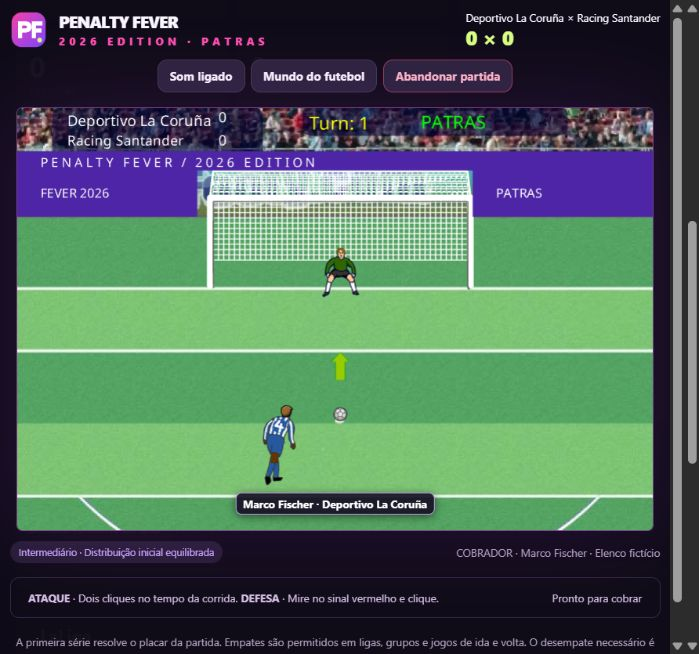

# Penalty Fever 2026 Edition

**Assinatura Patras.** O motor de cobranças do clássico Penalty Fever Plus, com identidade PF própria, temporadas e um modo Carreira que conecta o mundo do jogo.

## Jogar sem instalação

1. Baixe o [ZIP portátil](distribuicao/Penalty-Fever-2026-Edition.zip).
2. Extraia **toda a pasta** para um local de sua escolha.
3. Abra **JOGAR.html** em um navegador moderno com JavaScript e WebAssembly: Chrome, Edge ou Firefox, por exemplo.

O jogo inclui seus recursos. Não requer Flash instalado, Node, Python, terminal, conta, conexão ou permissão de administrador. A pasta pode ser copiada para outro computador. Navegadores antigos e políticas de computadores administrados podem impedir a abertura de arquivos locais. Windows, macOS e Linux dependem de um navegador compatível; não há executável nativo universal.

**Verificação da distribuição:** o carregador offline e os dois módulos WebAssembly foram validados sem acesso à rede. A interface e partidas foram testadas em navegador por uma prévia HTTP local. A política do navegador de testes bloqueou a abertura direta `file:`; o duplo clique no arquivo em cada sistema operacional não foi validado. Nenhuma proteção do navegador foi desativada.

## O que esta versão traz

- **PF**, com monograma, painéis, placas de campo e paleta próprios.
- **34 competições**, com **872 equipes únicas** na base inicial e **789 clubes** em nove sistemas nacionais. Europa: 2026/27; Brasil e Américas: 2026. Consulta: 27/10/2026.
- Divisões inferiores, grupos regionais e playoffs de acesso. Brasil A–D; Inglaterra até League Two; Espanha, Itália, Alemanha e França até a terceira divisão; Argentina com ramos paralelos; EUA e México com os recortes descritos em [FONTES.md](FONTES.md).
- **Carreira**: perfil do técnico, clube de qualquer divisão incluída, ligas e copas simultâneas, classificação internacional, propostas, transferências, histórico e relatório anual de campeões.
- Mundiais em ciclos de quatro anos e proposta da seleção de origem após conquistar um título intercontinental. A participação depende de classificação.
- Quatro dificuldades: **Fácil, Médio, Intermediário e Difícil**. A posição dos clubes atualiza o desafio nas ligas; a velocidade e o tempo de reação aumentam no mata-mata.
- Cobradores fictícios próprios de cada clube, alternados durante a disputa. Camisas editáveis e cores persistentes durante a corrida.
- Som durante a partida, consulta às outras ligas com o confronto pausado, exportação/importação de saves e armazenamento local comprimido.
- Abandono confirmado registra **0 × 1 a 0 × 5**. Fechar ou recarregar também gera a derrota na abertura seguinte. Saves não são protegidos contra edição manual ou restauração de backups antigos.

## Controles

**Ataque:** primeiro clique inicia a corrida; o segundo define a cobrança no tempo da animação. **Defesa:** mire no sinal vermelho e clique. No topo da partida ficam som, consulta ao mundo na Carreira e abandono. O áudio muda imediatamente; a consulta e a confirmação pausam a partida.

## Seus saves

Use **Baixar save** para levar uma carreira a outro navegador ou computador. O formato exportado é JSON, versão 3; as carreiras internas têm versão 1. A importação valida clubes, fases e resultados antes de aplicar os dados. O armazenamento local usa compressão sem perda. Vários perfis e arquivos independentes são permitidos; o limite de armazenamento depende do navegador. Se o jogo informar falta de espaço, exporte o save.

Trocar a pasta, limpar o navegador, usar navegação privada ou abrir em outro navegador pode separar ou apagar o armazenamento local. O JSON exportado é sua cópia de segurança. Importar um save feito durante uma partida aplica a regra de interrupção.

## Regras reais e adaptações do jogo

Cada confronto é uma disputa de pênaltis; não são partidas de 90 minutos. A base conserva os participantes e as estruturas principais das competições originalmente incluídas, com as simplificações do painel Regras. Calendários e datas são gerados pelo jogo. A base não recebe atualizações automáticas pela internet.

A Carreira usa um calendário anual integrado. Em 2026, Champions e Libertadores começam com os participantes da base oficial. Nos anos seguintes, vagas vêm das classificações simuladas dos países incluídos e de convidados. As copas nacionais da Carreira incluem os clubes disponíveis em eliminatórias próprias. Os torneios continentais futuros, a Intercontinental com quatro clubes e os Mundiais da Carreira têm **regras de classificação e formatos próprios da edição**. Não são uma reprodução de todos os regulamentos FIFA/UEFA/CONMEBOL.

Nos acessos, playoffs de Inglaterra, Espanha e Itália são adaptados aos pênaltis. Barrages que cruzam ligas alemãs/francesas, restrições de times B, critérios disciplinares, médias argentinas, certificações e distribuição geográfica futura são simplificados. Os ramos argentinos de nível 3 alimentam a Primera Nacional em paralelo. A Série C cresce para 24 clubes em 2027 e 28 em 2028; depois o jogo mantém esse tamanho. A última divisão incluída de cada país é o limite do universo, sem entradas e saídas para ligas amadoras ausentes. **MLS/USL e o sistema mexicano não têm acesso automático entre si.**

Nos Mundiais: seleções em 2026/2030/2034…; clubes em 2029/2033/2037… Para 2030 em diante, as eliminatórias do jogo usam 64 seleções em 16 grupos, com as três primeiras de cada grupo classificadas. O título intercontinental abre a possibilidade de comandar a seleção e garante uma vaga de clube no próximo ciclo dentro da janela de quatro anos. As demais vagas de clubes vêm da simulação.

Camisas e escudos são **conceituais**, com cores de referência e alternativas de contraste; não são réplicas licenciadas dos uniformes oficiais de 2026. Os elencos são fictícios. O arquivo clássico preserva nomes históricos separados da base atual. Esta versão cobre as divisões listadas, não toda a pirâmide amadora de cada país.

## Validação e código

O [relatório de testes](VALIDACAO.json) registra 170 temporadas completas, 66.295 partidas nessas temporadas e 41 anos de Carreira em testes, além de dificuldade, acesso, integridade de saves e carregamento offline. Testes de interface cobrem partida real, som, uniforme em movimento, abandono, interrupção, exportação/importação e consulta a ligas.

Para desenvolver, consulte [CODIGO-FONTE.md](CODIGO-FONTE.md). Para conferir os pedidos atendidos e suas adaptações, leia [MELHORIAS.md](MELHORIAS.md).

## Créditos

Penalty Fever Plus original: **FlashFooty / Vladeta M.**, 2009. O SWF original e parte dos gráficos, animações e áudio continuam sendo obras de seus autores. Esta é uma adaptação pessoal; não atribui a Patras a autoria do clássico nem declara licença comercial de redistribuição do original.

Emulação: **Ruffle 0.7.1**, licenças Apache 2.0/MIT em `app/LICENSE_APACHE` e `app/LICENSE_MIT`. Compressão: **lz-string 1.5.0**, de pieroxy, licença MIT em `app/LICENSE_LZ_STRING`. A disponibilidade pública do SWF não equivale a uma autorização de uso comercial. Fontes e procedência: [FONTES.md](FONTES.md).
